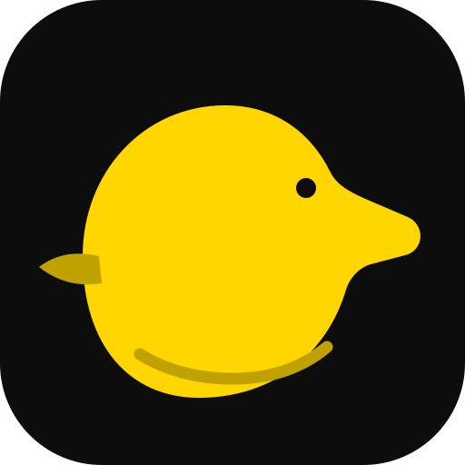

<h1 align="center">Fragile-Baby</h1>

<strong>Elbrus Architecture & Platform Qualification Workstream</strong>

<strong>Architecture proposal · target evidence pending</strong>

<a href="README.md">🇺🇦 Українська</a> · <a href="README.en.md">🇬🇧 English</a> · <a href="README.ru.md">🇷🇺 Русский</a>

> **Fragile-Baby** — Fragile-Baby is an engineering workstream for researching Elbrus/E2K and preparing verifiable platform qualification.

## Current capabilities
- CPU/SoC, stepping and ABI identity profiles.
- Toolchain, linker layout, image format and memory-map requirements.
- Versioned manifests for CPU, board revision and compiler toolchain.
- Host, cross-build, emulator and physical-target evidence matrix.

## Quick start and verification

This repository documents an Elbrus/E2K qualification workstream, not a ready target build. Review the toolchain, linker layout, image format and board requirements. A target build is possible only after the concrete toolchain and hardware are confirmed.

## Architecture and verified scope
No verified E2K target implementation, boot path or hardware qualification is present. Host tests do not prove Elbrus compatibility; platform parameters must not be inferred from another ISA.

## Engineering quality
- Run the checks appropriate to the target platform; host CI is not hardware qualification.
- Mark capabilities as implemented, partial or planned according to code, tests and evidence.
- A mockup, specification or open pull request is not proof of a production-ready feature.
- External integrations must be explicit, versioned, isolated and testable.

## NUN Mesh and related repositories
[SAMBU](https://github.com/bboroski/SAMBU) · [ToolNG](https://github.com/bboroski/ToolNG) · [ReaperCripple](https://github.com/bboroski/ReaperCripple) · [Kloz](https://github.com/bboroski/Kloz) · [CO](https://github.com/bboroski/CO) · [SaintSI](https://github.com/bboroski/SaintSI) · [Klipot](https://github.com/bboroski/Klipot) · [NUN](https://github.com/bboroski/NUN) · [NUNLauncher](https://github.com/bboroski/NUNLauncher) · [Fragile-Baby](https://github.com/bboroski/Fragile-Baby) · [Luci](https://github.com/bboroski/Luci)

Each repository retains its canonical name, code, APIs, release lifecycle and ownership boundaries. Integration means versioned contracts, not automatic merging of independent runtimes.

## Design and documentation
The shared interface direction is **Duck Black / Yellow**: near-black surfaces `#111111`, warning-yellow accents `#FFD600`, readable typography, accessible contrast, keyboard navigation and reduced-motion support. See [design/DUCK_UI_SYSTEM.md](design/DUCK_UI_SYSTEM.md) when present.

## License
License not declared; no LICENSE file is present.

---
**Built with care for engineering, clarity and people.**

## Duck Black / Yellow palette
The legacy badge and mark compatibility colors remain `#FFD600` (yellow) and `#111111` (near-black). The current interface canvas is `#0D0D0D`. The complete six-color palette, fourteen functional shades and RGB/HSL values are maintained in `design/duck-ui.tokens.json` (schema 3.0.0). Yellow is reserved for primary actions, focus and selection; red and cyan identify semantic error and information states.
