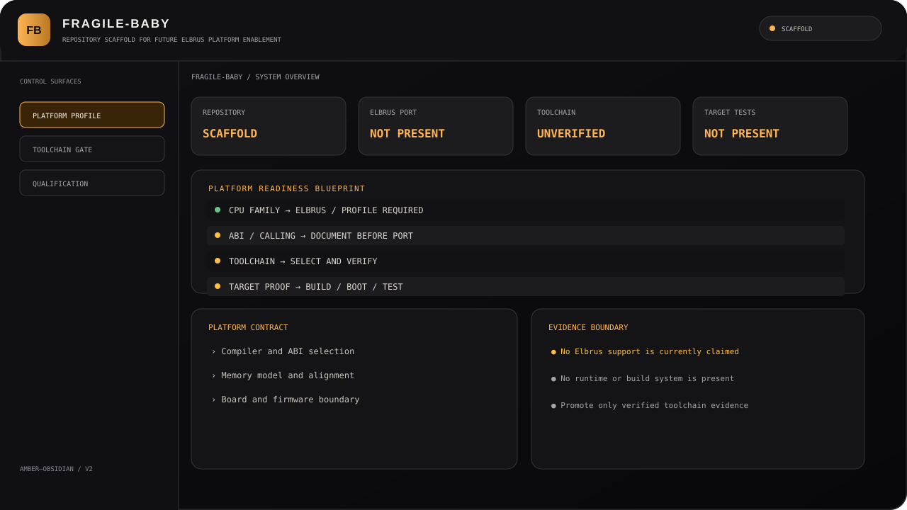

# Fragile-Baby

**Status:** project placeholder and integration-reference scaffold.

The repository currently contains no product implementation, public API, build system, supported hardware target, or test suite. Its intended product role still needs to be defined; this README deliberately does not invent one.

## Cross-project domain references

- [Reaper-inspired engineering integration notes](docs/REAPER_DOMAIN_INTEGRATION.md)
- [Canonical 50-pattern engineering catalogue in SAMBU](https://github.com/bboroski/SAMBU/blob/main/data/reaper/engineering_patterns_50.tsv)
- [Academic biology glossary in SAMBU](https://github.com/bboroski/SAMBU/blob/main/data/biology/academic_terms_500.tsv)

These references are passive documentation and research vocabulary only. They do not imply that Fragile-Baby implements a runtime, biological model, AI system, hardware controller, or Mass Effect technology.

## Promotion gate

Before implementation, define the repository owner role, supported platforms, public interfaces, threat model, build/test strategy, licensing requirements, and dependency direction. Only then should executable code or ecosystem capabilities be introduced. Any future integration must be versioned, independently testable, and reversible.

## Closed-domain metric and boundary model

- [Project-specific boundary and invariant mapping](docs/CLOSED_DOMAIN_METRIC_INTEGRATION.md)
- [Canonical CDM-1 specification and validator](https://github.com/bboroski/SAMBU/blob/main/docs/CLOSED_DOMAIN_METRIC.md)

## Візуальна система · Amber–Obsidian v2

Індивідуальна графічна мова **Fragile-Baby**: обсидіановий фон, графітові поверхні та власний бурштиновий акцент. Візуальні маркери стану відокремлюють готові, невідомі й ще не реалізовані можливості.

[Специфікація інтерфейсу та меж реалізації](docs/INTERFACE_DESIGN.md).
