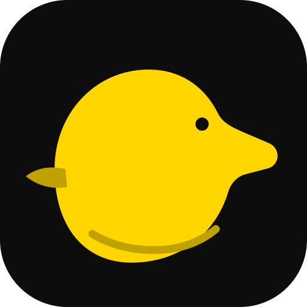

<p align="center"></p>
<h1 align="center">Fragile-Baby</h1>
<p align="center"><strong>Elbrus Architecture & Platform Qualification Workstream</strong></p>
<p align="center"><strong>Архитектурное предложение · доказательства целевой платформы ожидаются</strong></p>
<p align="center"><a href="README.md">🇺🇦 Українська</a> · <a href="README.en.md">🇬🇧 English</a> · <a href="README.ru.md">🇷🇺 Русский</a></p>

> **Fragile-Baby** — Fragile-Baby — инженерное направление исследования Elbrus/E2K и подготовки проверяемой квалификации платформы.

## Текущие возможности
- Профили идентичности CPU/SoC, stepping и ABI.
- Требования к toolchain, linker layout, image format и memory map.
- Версионированные manifest для CPU, board revision и compiler toolchain.
- Матрица доказательств host, cross-build, emulator и physical target.

## Быстрый старт и проверка
```bash
Изучите спецификации и qualification documents; сборка под target требует конкретного toolchain и оборудования.
```

## Архитектура и подтверждённые границы
Проверенная E2K target-реализация, boot path или аппаратная квалификация отсутствуют. Host-тесты не доказывают совместимость с Elbrus; параметры нельзя выводить из другой ISA.

## Инженерное качество
- Запускайте проверки для целевой платформы; host CI не заменяет аппаратную квалификацию.
- Статусы implemented, partial и planned должны подтверждаться кодом, тестами и доказательствами.
- Макет, спецификация или открытый Pull Request не доказывают production-ready реализацию.
- Внешние интеграции должны быть явными, версионированными, изолированными и тестируемыми.

## NUN Mesh и связанные репозитории
[SAMBU](https://github.com/bboroski/SAMBU) · [ToolNG](https://github.com/bboroski/ToolNG) · [ReaperCripple](https://github.com/bboroski/ReaperCripple) · [Kloz](https://github.com/bboroski/Kloz) · [CO](https://github.com/bboroski/CO) · [SaintSI](https://github.com/bboroski/SaintSI) · [Klipot](https://github.com/bboroski/Klipot) · [NUN](https://github.com/bboroski/NUN) · [NUNLauncher](https://github.com/bboroski/NUNLauncher) · [Fragile-Baby](https://github.com/bboroski/Fragile-Baby) · [Luci](https://github.com/bboroski/Luci)

Каждый репозиторий сохраняет каноническое имя, собственный код, API, цикл выпуска и границы ответственности. Интеграция означает версионированные контракты, а не автоматическое слияние независимых runtime.

## Дизайн и документация
Общее направление интерфейсов — **Duck Black / Yellow**: тёмные поверхности, жёлтые акценты для действий и состояний, читаемая типографика, доступный контраст, клавиатурная навигация и поддержка reduced motion. Подробности — в [design/DUCK_UI_SYSTEM.md](design/DUCK_UI_SYSTEM.md), если файл присутствует.

## Лицензия
Лицензия не объявлена; файл LICENSE отсутствует.

---
**Создано с любовью к инженерии, системности и людям.**


## Палитра Duck Black / Yellow
Совместимые цвета прежних badges и marks: `#FFD600` (жёлтый) и `#111111` (почти чёрный). Текущий фон интерфейса — `#0D0D0D`. Полная палитра из шести цветов, четырнадцати функциональных оттенков и значения RGB/HSL находятся в `design/duck-ui.tokens.json` (schema 3.0.0). Жёлтый зарезервирован для основных действий, фокуса и выделения; красный и голубой обозначают семантические ошибки и информационные состояния.
